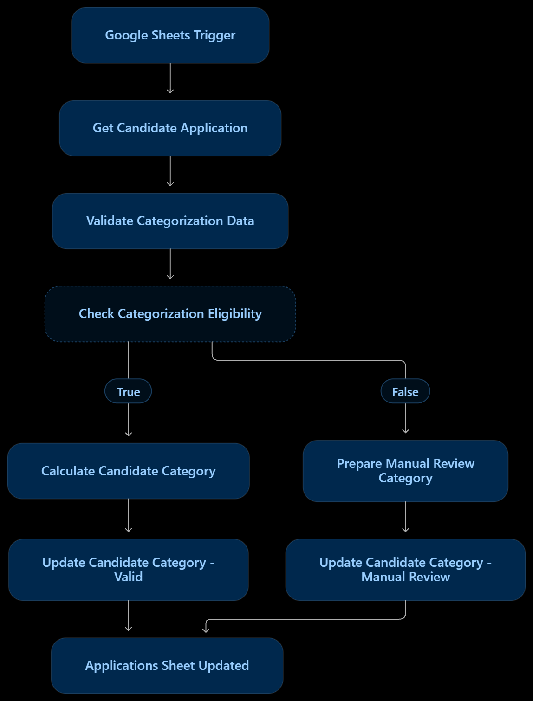

# WF-05 — Candidate Categorization

## 1. Overview & Objectives

### 1.1 Overview
The Candidate Categorization workflow is the fifth workflow in the AI-Powered HR Recruitment Automation System. It processes the AI-generated candidate match score and matching explanation from the previous workflow to assign candidates into predefined recruitment categories.

This workflow uses rule-based logic in n8n to classify candidates according to their match score, while validating the incoming data and routing applications that cannot be reliably categorized to a manual review pathway.

### 1.2 Objectives
- Automatically categorize candidates based on valid AI match scores.
- Apply consistent, predefined categorization thresholds.
- Validate score and explanation data before categorization.
- Route invalid, missing, or flagged records to manual review.
- Update the Candidate Category field in Google Sheets.
- Preserve application status and other candidate information.
- Support HR decision-making without replacing human judgment.

### 1.3 Scope
This workflow handles candidate categorization only. It does not independently approve, reject, hire, or disqualify candidates. All categories are advisory labels intended to help HR organize and review applications.

## 2. Workflow Architecture & Trigger Configuration

### 2.1 Workflow Architecture
WF-05 operates as a rule-based processing workflow within the recruitment automation pipeline. It receives candidate application updates, retrieves the relevant application data, validates the required fields, and routes the record through either the valid categorization pathway or the manual review pathway.

The workflow consists of the following major components:

1. **Google Sheets Trigger** — detects changes to specified candidate application fields.
2. **Get Candidate Application** — retrieves the application record using its Application ID.
3. **Validate Categorization Data** — checks the Application ID, AI Match Score, Matching Explanation, and manual review indicators.
4. **Check Categorization Eligibility** — determines whether the application is eligible for automated categorization.
5. **Calculate Candidate Category** — assigns a category based on the predefined score ranges.
6. **Prepare Manual Review Category** — prepares a Manual Review outcome when validation fails or the application requires human verification.
7. **Google Sheets Update Nodes** — update the Candidate Category field in the Applications sheet.

### 2.2 Trigger Configuration
The workflow uses a Google Sheets Trigger to monitor the Applications sheet in the `AI-HR-Recruitment-Database` spreadsheet.

| Configuration | Value |
|---|---|
| Trigger type | Google Sheets Trigger |
| Event | On Row Updated |
| Polling interval | Every minute |
| Spreadsheet | AI-HR-Recruitment-Database |
| Sheet | Applications |
| Watched fields | AI Match Score, Matching Explanation |

The trigger initiates categorization when the monitored fields are updated, allowing the workflow to process candidate records after the AI Candidate Matching workflow has produced its results.

### 2.3 Application Record Retrieval
After the trigger executes, the workflow retrieves the candidate's application data using the Application ID as the matching key.

The retrieval step ensures that the categorization process receives the application fields required for validation and processing. The workflow is designed to process incoming application records as individual items, preserving the relationship between each candidate application and its corresponding categorization result.

## 3. Categorization Rules & Score Thresholds

### 3.1 Categorization Logic
WF-05 uses predefined score ranges to assign candidate categories. Categorization is performed using JavaScript code nodes in n8n without making additional AI API calls.

### 3.2 Category Thresholds

| AI Match Score | Assigned Category |
|---|---|
| 80–100 | Strong Match |
| 60–79 | Potential Match |
| 0–59 | HR Review |
| Invalid, missing, or unreliable data | Manual Review |

### 3.3 Category Descriptions

**Strong Match:** Candidates whose AI match score falls between 80 and 100. These candidates appear to align strongly with the job requirements and may be prioritized for HR review.

**Potential Match:** Candidates scoring between 60 and 79. These candidates demonstrate a potential fit and may require closer evaluation of their skills, experience, and qualifications.

**HR Review:** Candidates scoring between 0 and 59. This category indicates that the application requires HR assessment to determine suitability. A low score is not an automatic rejection.

**Manual Review:** Applications with missing or invalid scores, missing matching explanations, out-of-range scores, or a manual-review flag from the previous workflow are routed to manual verification instead of normal score-based categorization.

### 3.4 Threshold Limitations
The categorization thresholds are heuristic values selected for this prototype. They have not been scientifically validated against hiring outcomes or a representative recruitment dataset. Categories are intended to assist HR personnel with application organization and review, not to establish candidate suitability conclusively.

## 4. Data Validation & Manual Review Handling

### 4.1 Purpose of Data Validation

Before assigning a candidate category, the workflow validates the application data to ensure that the AI Match Score and Matching Explanation are present and reliable enough for automatic categorization. If the required information is missing, invalid, or indicates a manual review requirement, the application is routed to the manual review branch.

### 4.2 Validation Conditions

The **Validate Categorization Data** Code node checks the following conditions:

| Validation | Condition |
|---|---|
| Application ID | Must be present and non-empty. |
| AI Match Score | Must be present and numeric. |
| Score range | Must be between 0 and 100. |
| Matching Explanation | Must be present and non-empty. |
| Manual review flag | If the explanation contains `MANUAL REVIEW REQUIRED`, automatic categorization is blocked. |

### 4.3 Categorization Eligibility

The workflow collects validation errors during processing. The `categorizationReady` variable is set to `true` only when all validation checks pass.

- **Eligible:** No validation errors are detected; the application proceeds to the category calculation branch.
- **Not eligible:** One or more validation errors are detected; the application proceeds to the manual review branch.

### 4.4 Manual Review Handling

Applications that fail validation are assigned the category **Manual Review**. The workflow also generates a review explanation describing why automatic categorization was not completed and recommends that HR verify the application, score, and matching explanation before proceeding.

This explanation is generated in the workflow output and is not written to the Google Sheets database.

### 4.5 Safety & Reliability

Validation prevents missing, invalid, or flagged data from being used for automatic categorization. The manual review branch acts as a safeguard against unreliable AI matching data and ensures that uncertain applications are not automatically classified without further verification.

## 5. Candidate Category Calculation

### 5.1 Category Calculation Logic

The **Calculate Candidate Category** Code node uses JavaScript to assign a candidate category based on the validated AI Match Score. The node executes once for each incoming item, allowing multiple applications to be processed independently.

The categorization is performed using predefined score ranges without requiring another AI API call.

### 5.2 JavaScript Categorization Conditions

The following conditions are used to assign candidate categories:

| Score Condition | Assigned Category |
|---|---|
| 80–100 | Strong Match |
| 60–79 | Potential Match |
| 0–59 | HR Review |
| Invalid score or unexpected value | Manual Review |

The code first converts the validated score into a number and then evaluates the conditions sequentially to determine the appropriate category.

### 5.3 Category Output

After calculation, the Code node returns the original application data along with the newly calculated `candidateCategory` field. This preserves the existing data while adding the result required for the next Google Sheets update step.

### 5.4 Processing Multiple Applications

The node is configured to **Run Once for Each Item**. This allows each candidate application to receive an independent category based on its own match score without mixing information between applications.

### 5.5 Role of the Categorization Logic

The categorization logic provides a consistent, repeatable method of grouping applications according to their AI Match Scores. These categories assist HR in prioritizing applications but do not represent final hiring decisions.

## 6. Google Sheets Update & Data Integrity

### 6.1 Purpose of the Database Update

After candidate categorization is completed, WF-05 updates the corresponding application record in the Google Sheets database. The update stores the calculated Candidate Category so that HR can view and use it during recruitment screening.

### 6.2 Application Record Identification

The workflow uses the **Application ID** to identify the correct candidate record. This ensures that the category is written to the matching application rather than relying on a candidate's name or email address.

### 6.3 Fields Updated

WF-05 updates only the following fields in the Applications sheet:

| Field | Purpose |
|---|---|
| Application ID | Identifies the application record used for matching. |
| Candidate Category | Stores the calculated category or Manual Review label. |

Both the valid categorization branch and manual review branch use their respective Google Sheets Update Row nodes.

### 6.4 Data Integrity & Protection

The workflow is designed to preserve existing application data. It does not modify:

- AI Match Score
- Matching Explanation
- Application Status
- Candidate personal information
- Other application fields

Only the Candidate Category is updated as a result of this workflow.

### 6.5 Trigger Loop Prevention

The Google Sheets Trigger monitors changes to the **AI Match Score** and **Matching Explanation** columns rather than the Candidate Category column.

This prevents the workflow's own category update from unnecessarily retriggering the categorization process and helps avoid repeated execution loops.

### 6.6 Database Consistency

By matching records through Application ID and restricting the update mapping to the intended fields, WF-05 maintains consistency in the Applications sheet while keeping candidate categorization separate from the recruitment status and AI matching stages.

## 7. Workflow Execution Flow

### 7.1 Overall Execution Sequence

WF-05 follows a structured sequence to process candidate applications and assign appropriate categories. It begins when relevant AI matching fields are updated in Google Sheets and ends when the resulting category is stored in the Applications sheet.

The workflow consists of the following stages:

1. **Trigger Detection:** Google Sheets Trigger detects an update to AI Match Score or Matching Explanation.
2. **Application Retrieval:** The Get Candidate Application node retrieves the application using its Application ID.
3. **Data Validation:** Validate Categorization Data checks the application ID, score, explanation, score range, and manual review conditions.
4. **Eligibility Check:** Check Categorization Eligibility determines whether the application can proceed with automatic categorization.
5. **Branch Processing:**
   - Valid data proceeds to Calculate Candidate Category.
   - Invalid, missing, or flagged data proceeds to Prepare Manual Review Category.
6. **Category Assignment:** The workflow assigns Strong Match, Potential Match, HR Review, or Manual Review.
7. **Database Update:** The corresponding Google Sheets Update Row node writes the Candidate Category using Application ID.
8. **Completion:** The candidate record is updated while other application fields remain unchanged.

### 7.2 Workflow Architecture Diagram

**Figure 7.1: WF-05 Candidate Categorization Workflow**

The diagram illustrates the main execution path, eligibility decision, valid categorization branch, and manual review branch.

### 7.3 Execution Outcome

The workflow provides a consistent categorization process for candidate applications. Valid records are categorized using predefined score thresholds, while records requiring additional verification are assigned Manual Review. The final category is stored in Google Sheets for HR reference.

## 8. Testing & Verification

### 8.1 Testing Overview

WF-05 was tested to verify that candidate applications are validated, categorized correctly, routed appropriately, and updated in the Google Sheets database. Testing was performed using test applications and the workflow's execution results.

### 8.2 Test Scenarios

| Test Scenario | Expected Result | Status |
|---|---|---|
| Valid categorization data | Application proceeds to score-based categorization. | Passed |
| Manual review condition | Application is routed to Manual Review. | Passed |
| Candidate category calculation | Appropriate category is assigned based on score thresholds. | Passed |
| Google Sheets update | Candidate Category is updated in the correct application record. | Passed |
| Data integrity | Other application fields remain unchanged. | Passed |
| Trigger and application retrieval | Relevant data is received and retrieved successfully. | Passed |

### 8.3 Test Results

The workflow executed successfully through the valid categorization and manual review branches. Candidate category updates were verified in Google Sheets, and the workflow preserved the other application fields.

The testing process confirmed that the workflow handles valid categorization data and applications requiring manual review as intended.

### 8.4 Verification Summary

The workflow was inspected node by node, including its configurations, execution outcomes, branch logic, and Google Sheets mappings. All required test scenarios passed, and no unresolved issues were identified during verification.

WF-05 is considered functionally verified for the tested scenarios. It remains inactive until the complete recruitment automation system is integrated and approved for activation.

## 9. Limitations, Ethics & Safeguards

### 9.1 Limitations of Candidate Categorization

The candidate categorization system relies on AI Match Scores produced by WF-04 and predefined score thresholds. These thresholds are heuristic values and have not been scientifically validated against real recruitment outcomes.

Candidate categories therefore indicate preliminary screening priorities rather than definitive candidate quality or suitability.

### 9.2 AI-Assisted Decision Making

WF-05 is designed to assist HR personnel by organizing candidate applications into categories. It does not independently make hiring, rejection, or employment decisions.

All final recruitment decisions must remain under the responsibility of qualified human HR personnel.

### 9.3 Bias Prevention

Candidate categorization should rely on job-related qualifications and evidence, including relevant skills, experience, education, and projects.

Protected or sensitive attributes such as gender, religion, caste, ethnicity, disability, or other irrelevant personal characteristics must not be used as categorization criteria.

### 9.4 Human Oversight

Applications marked Manual Review require human verification before HR proceeds with further recruitment actions. HR personnel should review the underlying application, matching score, and explanation rather than relying solely on the assigned category.

### 9.5 Data Privacy & Security

Candidate information should be handled securely and accessed only by authorized personnel. Resume data and recruitment records should be retained only as required for the intended recruitment purpose and according to the applicable retention policy.

### 9.6 Responsible Use

The categorization workflow is a supporting automation tool. Its purpose is to improve consistency and efficiency in candidate organization while maintaining transparency, fairness, privacy, and human accountability throughout the recruitment process.

## 10. Conclusion

WF-05 – Candidate Categorization successfully automates the classification of candidate applications using AI Match Scores generated by the previous workflow. By applying predefined score thresholds, validating application data, and routing uncertain cases to manual review, the workflow provides a consistent and structured approach to candidate screening support.

The workflow integrates with the Google Sheets recruitment database and updates only the Candidate Category field, preserving other application information. Its rule-based approach reduces unnecessary AI API usage while maintaining predictable categorization behavior.

Although WF-05 improves screening organization and reduces manual categorization effort, its results remain advisory. Human HR personnel retain responsibility for evaluating candidates and making all final recruitment decisions.

The workflow has been configured, tested, documented, and exported successfully. It remains inactive until integration with the complete recruitment automation system and final approval.
